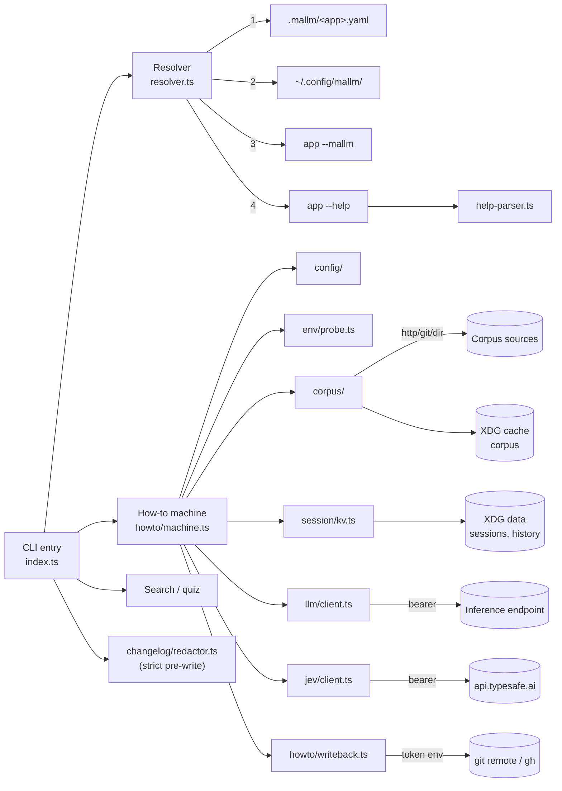

# Project Architecture

## Overview

`mallm` is a CLI that provides structured, LLM-friendly documentation for command-line tools and
an executable how-to pipeline on top of it. It resolves documentation from several sources via a
priority chain, folds in OS/env context, machine-readable help text and a cached how-to corpus, and
emits Markdown or JSON for agents and humans. Since the SemText waves it also runs a resumable,
approval-gated pipeline that drafts bash scripts, installs missing tools, executes the script, and
writes the validated how-to back to a corpus source.

The codebase is a single-process Node.js CLI (~6k lines of TypeScript) with **no server, no
listener, and no database**. It does have local file-backed state (sessions, history, knowledge,
corpus cache) under XDG dirs and makes outbound network calls only on explicit user action: corpus
source sync, LLM inference, the Jev (TypeSafe systemone) client, and write-back push/PR.

## System Diagram

## Core Components

| Component | Directory | Purpose |
|-----------|-----------|---------|
| CLI | `src/index.ts` | Commander entry; all commands and global flags |
| Resolver | `src/resolver.ts` | 4-tier mallm.yaml resolution | 
| Formatter | `src/formatter.ts` | Markdown render / JSON with `_meta` provenance |
| Help parser | `src/help-parser.ts`, `src/init.ts` | `--help` → mallm structure; stub scaffolding |
| Schema | `src/schema.ts`, `schemas/` | TypeScript types + canonical JSON Schema |
| Platform config | `src/config/` | `.mallm/config.yaml` → `~/.config/mallm/config.yaml` → defaults (v1.1) |
| Corpus | `src/corpus/` | http/git/dir adapters, ETag + commit caching, priority merge |
| Env probe | `src/env/` | OS/arch/shell, PATH tool scan, installer detection |
| Session | `src/session/` | 4-glyph tokens + file-backed `SessionKV` buckets |
| History | `src/changelog/` | append-only redacted `history.jsonl` |
| Inference | `src/llm/` | Minimal OpenAI-compatible chat; typed no-inference degrade |
| Jev | `src/jev/` | TypeSafe systemone quiz client + answer application |
| Memory | `src/memory/` | Tier resolution (universal/org/project/user) + `knowledge.yaml` |
| Search | `src/search/` | Hand-rolled BM25 over corpus docs and `howtos[]` entries |
| How-to | `src/howto/` | Resumable state machine, drafts, script planning, write-back |

→ *Components ↔ directories: see [PROJ-LAYOUT.md](PROJ-LAYOUT.md)*

## Resolution Chain

`resolve_mallm` tries four sources in order, returning the first hit:

1. **Project-local** — `.mallm/<app>.yaml` at the nearest `.mallm/` or `.git/` ancestor
2. **User config** — `~/.config/mallm/<app>/mallm.yaml` (`<version>/` and `latest/` variants probed)
3. **Native protocol** — executes `<app> --mallm`, expects YAML on stdout
4. **Help fallback** — parses `<app> --help` into a basic `MallmConfig`

Each result carries a `source` tag (`project-local`, `user-config`, `native`, `help-generated`) and
optional `path`, surfaced by the formatter as provenance (`_meta` in JSON).

## Platform Config (v1.1)

Configuration layers on top of the resolver chain: project `.mallm/config.yaml` overrides user
`~/.config/mallm/config.yaml`, over defaults. Keys: `sources[]` (http|git|dir with `url`/`repo`+
`branch`/`priority`/`credsRef`/`tokenEnv`), `inference{baseUrl,apiKeyEnv,model}`,
`redaction.patterns[]`, `sessionTtl`. v1.0 definitions remain valid — every accessor fills defaults.

## How-to Pipeline

`mallm how-to` is a resumable state machine; one CLI invocation loads state from the session KV,
advances as far as the recorded approvals allow, and persists. Stages: INTAKE (env probe + corpus +
memory tiers) → DRAFT (2–3 candidate bash scripts via `llm/` when configured, corpus/BM25 otherwise,
template fallback) → SELECT → GATE_INSTALL → GATE_RUN → OBSERVE → DIAGNOSE+PATCH (≤3 attempts) →
SUCCESS → WRITEBACK → CLOSE.

Gate discipline: **there is no `--yes`.** Approval ids are plan-hash-scoped (install) or
per-attempt (run); decisions land in the session `approvals` bucket via
`mallm session approve|deny <token> <id>` or the single-invocation `--approve-install` /
`--approve-run` flags. Script output is redacted **strictly before** it is persisted; write-back
appends a `howtos:` entry to the corpus source doc (dir = local commit, git = branch + push + PR).

→ *Details: [PROJ-HOWTO.md](PROJ-HOWTO.md)*

## Local State

Everything mallm writes is local, under XDG-overridable paths:

| State | Path | Shape |
|-------|------|-------|
| Session KV | `$XDG_DATA_HOME/mallm/sessions/<token>.json` | buckets: env/downloads/installed/approvals/decisions/howto |
| History | `$XDG_DATA_HOME/mallm/history.jsonl` | append-only, pre-redacted |
| Corpus cache | `$XDG_CACHE_HOME/mallm/corpus/<key>/` | payload + `meta.json` |
| Knowledge | `~/.config/mallm/knowledge.yaml` | topics with confidence |
| Run scripts | `$XDG_CACHE_HOME/mallm/howto/<token>/run-N.sh` | generated, mode 0755 |

No database. No credentials are read except the env var **names** named in config (`apiKeyEnv`,
`tokenEnv`) — values are never stored by mallm.

## Security-Relevant Design

Outbound and execution surfaces are gated and redacted by construction: inference/Jev keys travel
only in an `Authorization` header and error strings carry env **names**; write-back pushes
authenticate through an env-injected git credential helper (token never in argv or URLs) with
`GH_TOKEN` for `gh`; how-to script execution requires an explicit per-attempt approval and its
output is redacted before persistence. The remaining shells (`resolver.ts` native/help tiers,
`init.ts`) still interpolate the `app` argument into `execSync` template strings — see
[THREAT-MODEL.md](THREAT-MODEL.md).

## Ecosystem Fit

`mallm` is a portfolio submodule of the Noizu Infra monorepo
(`Portfolio/Utilities/source/mallm`, remote `the-robot-lives/mallm`, branch `develop`) but is
deliberately decoupled from the shell-utility conventions of its siblings: it is a standalone Node
package with no `k8-lib` dependency, no `.infra-config.yaml` coupling, and an npm-link install (the
`Makefile` is monorepo hook stubs only). It documents those sibling DevOps CLIs for LLM agents.

## Key Decisions

- **YAML authoring, JSON output** — humans write `mallm.yaml`; JSON is output-only.
- **Filesystem resolution over a registry** — definitions travel with projects; no central database.
- **Degrade, never throw** — inference, Jev, corpus and write-back all return typed results; every
  path (unconfigured, offline, malformed) yields usable output.
- **No new dependencies for search** — BM25 is hand-rolled rather than pulling an embedding stack.
- **Approval gates with no bypass** — the how-to pipeline cannot install or run without an explicit,
  scoped decision; redaction has no escape hatch.
- **Lightweight `validate`** — structural checks in code; `schemas/mallm.schema.json` remains the
  canonical contract.

## Technology Stack

| Layer | Choice |
|-------|--------|
| Runtime | Node.js ≥20 (ESM) |
| Language | TypeScript 5.8 |
| CLI framework | Commander 13 |
| YAML | `yaml` 2.7 |
| Terminal styling | Chalk 5 |
| Build | `tsc` (no bundler) |
| Tests | `node:test` via `tsx` |
