# Project Schema — mallm

> **No relational database.** mallm has no SQL schema, no Liquibase changelogs, and no DB of any
> kind. It is not, however, stateless: it defines and persists several **file-backed** data shapes
> under XDG-overridable paths — the `mallm.yaml` documentation format and its JSON Schema, the
> platform config file, the session KV, the redacted history log, `knowledge.yaml`, the corpus cache
> metadata, and the `howtos[]` write-back section. This document covers each. For code organization
> see [PROJ-LAYOUT.md](PROJ-LAYOUT.md); for how they are used see [PROJ-ARCH.md](PROJ-ARCH.md).

## Data inventory

| Artifact | Kind | Location | Authority |
|----------|------|----------|-----------|
| `mallm.yaml` | YAML doc | project `.mallm/` / `~/.config/mallm/` / native stdout | `schemas/mallm.schema.json` |
| Platform config | YAML doc | `.mallm/config.yaml` / `~/.config/mallm/config.yaml` | `src/config/types.ts` |
| Session KV | JSON | `$XDG_DATA_HOME/mallm/sessions/<token>.json` | `src/session/kv.ts` |
| History log | JSONL | `$XDG_DATA_HOME/mallm/history.jsonl` | `src/changelog/history.ts` |
| Knowledge | YAML doc | `~/.config/mallm/knowledge.yaml` | `src/memory/knowledge.ts` |
| Corpus cache meta | JSON | `$XDG_CACHE_HOME/mallm/corpus/<key>/meta.json` | `src/corpus/cache.ts` |
| Corpus payload / clone | raw + git | `$XDG_CACHE_HOME/mallm/corpus/<key>/` | `src/corpus/adapters.ts` |
| Run scripts | shell | `$XDG_CACHE_HOME/mallm/howto/<token>/run-N.sh` | `src/howto/cli.ts` |

## mallm.yaml — the mallm file format

Canonical definition: `schemas/mallm.schema.json` (JSON Schema draft 2020-12,
`$id https://mallm.dev/schemas/mallm.schema.json`). Also printable via `mallm schema`.

```mermaid
graph TD
    M[mallm.yaml] --> R[required: mallm / name / summary]
    M --> U[usage — synopsis, examples]
    M --> A[arguments — typed flag/option/positional/variadic]
    M --> S[subcommands — nested commands]
    M --> E[environment — required/optional env vars]
    M --> F[files — paths the tool reads/writes]
    M --> K[skills — links to extended docs]
    M --> L[related — sibling commands]
    M --> C[context — when_to_use, patterns, gotchas]
    M --> O[output — stdout/stderr/exit_codes/formats]
    M --> I[install — method/command/url]
    M --> P[platform v1.1 — sources / inference / redaction / sessionTtl]
    M -.written back.-> H[howtos — validated script sections]
```



### Section reference

| Section | Type | Required | Contents |
|---------|------|----------|----------|
| `mallm` | string | Yes | Schema version — `"1.0"` or `"1.1"` |
| `name` | string | Yes | Command name |
| `summary` | string | Yes | One-line description |
| `version` | string | No | Tool version |
| `description` | string | No | Multi-line detail |
| `usage` | object | No | `synopsis`; `examples[]` `{command, description, output?}` |
| `arguments[]` | array | No | `{name, type, description}` required; optional `required`, `default`, `value`, `choices[]` |
| `subcommands[]` | array | No | `{name, summary}` required; optional `description`, `arguments`, `examples` |
| `environment[]` | array | No | `{name, description}` required; optional `required`, `default` |
| `files[]` | array | No | `{path, description}` |
| `skills[]` | array | No | `{name, description}` required; optional `path`, `url` |
| `related[]` | array | No | `{name, description}` |
| `context` | object | No | `when_to_use`, `when_not_to_use`; `common_patterns[]`; `gotchas[]` |
| `output` | object | No | `stdout`, `stderr`, `exit_codes`, `formats[]` |
| `install` | object | No | `method`, `command`, `url` |

`argument.type` enum: `flag` · `option` · `positional` · `variadic`.

**Validation**: `mallm validate <path>` performs structural checks only (required top-level fields,
`mallm` ∈ {1.0,1.1}, per-argument `name`/`type`/`description`); it does not run the JSON Schema, which
remains the authoritative contract.

### Runtime-added fields (JSON output)

`mallm show <app> --json` emits `{doc, docSource, docPath, os, help, corpus, session}` — the fold
context is not part of the schema. `formatJson` also adds a `_meta` object (`source`, path).

### `howtos[]` (write-back section)

`mallm how-to` appends a section entry per validated run; it is written by `src/howto/writeback.ts`
and is **not yet** declared in the JSON Schema:

| Field | Type | Notes |
|-------|------|-------|
| `title` | string | Goal truncated to 200 |
| `goal` | string | Goal truncated to 500 |
| `os` | string[] | From the intake probe |
| `tags` | string[] | Currently empty |
| `script` | string | The validated bash script |
| `provenance` | object | `{session, createdAt, attempts}` |

## Platform config (v1.1)

Project `.mallm/config.yaml` overrides user `~/.config/mallm/config.yaml`, over defaults
(`src/config/types.ts`).

| Key | Type | Default | Notes |
|-----|------|---------|-------|
| `sources[]` | array | `[]` | corpus sources, merged lower-`priority`-first |
| `sources[].name` | string | — | unique |
| `sources[].kind` | enum | — | `http` · `git` · `dir` |
| `sources[].url` | string | — | http URL / dir path |
| `sources[].repo` / `branch` | string | `main` | git clone target |
| `sources[].priority` | number | `100` | lower wins; ties break on name |
| `sources[].credsRef` | string | — | credential **name**, never a value |
| `sources[].tokenEnv` | string | — | env var **name** for write-back push/PR token |
| `inference` | object | `{}` | `{baseUrl, apiKeyEnv, model}` |
| `redaction.patterns[]` | string[] | `[]` | extra regex sources for the redactor |
| `sessionTtl` | number | `86400` | seconds; `session clear --expired` uses it |

## Session KV

`src/session/kv.ts`. File `$XDG_DATA_HOME/mallm/sessions/<token>.json`:

```mermaid
graph TD
    S[session JSON] --> T[token]
    S --> C[createdAt]
    S --> U[updatedAt]
    S --> B[buckets]
    B --> E[env — probe snapshot]
    B --> D[downloads — items[]]
    B --> I[installed — items[]]
    B --> A[approvals — requestId → decision]
    B --> X[decisions — key → value]
    B --> H[howto — run state]
```

- Every bucket is a `Record<string, unknown>`; list-shaped buckets use the reserved key `"items"`
  (managed via `push()`/`items()` — `set("items", …)` throws).
- Tokens are 4 glyphs: UUIDv5(SHA-1 over `mallm-session:<iso>:<host>:<pid>:<counter>[:<attempt>]`)
  encoded base-5744 over the doc-pointers hieroglyph charset, collision-retried up to 8 attempts.
- Malformed JSON sanitizes to an empty session — never a throw.

## History log

`src/changelog/history.ts`. Append-only JSONL at `$XDG_DATA_HOME/mallm/history.jsonl`, one record
per line:

| Field | Type | Notes |
|-------|------|-------|
| `ts` | string | ISO timestamp |
| `session` | string | token, or `adhoc` |
| `action` | string | e.g. `how-to`, `sources.update`, `session.clear` |
| `command` | string | argv joined |
| `files` | string[] | touched paths |
| `outcome` | string | short result |
| `redactions` | string[] | rule ids that fired |

Every string field is passed through `redact()` **before** the write; there is no raw-output path.
Redaction rule ids: `pem` · `cred-url` · `bearer` · `env-assign` · `config-pattern` · `entropy`.

## knowledge.yaml

`src/memory/knowledge.ts`. `~/.config/mallm/knowledge.yaml` (user tier), `{topics: [...]}`:

| Field | Type | Notes |
|-------|------|-------|
| `id` | string | topic id (tool slug) |
| `name` | string | display name |
| `confidence` | number | 0–10, clamped |
| `lastSeen` | string | ISO timestamp |
| `sources` | string[] | provenance source names, sorted |

Topics sorted by id; `upsertTopic` takes max confidence and unions sources.

## Corpus cache

`src/corpus/cache.ts`. `$XDG_CACHE_HOME/mallm/corpus/<cacheKey>/` where `cacheKey` is the first 24
hex chars of `sha256("<kind>:<name>:<repo|branch or url>")`. Holds `payload` (http), a shallow git
clone (git), and `meta.json`:

| Field | Type | Notes |
|-------|------|-------|
| `key` | string | cache key |
| `etag` | string | http revalidation token |
| `commit` | string | git HEAD at last sync |
| `sha256` | string | payload digest |
| `fetchedAt` | string | ISO timestamp |

## Environment / secrets

mallm reads no secret *values* itself. It reads two classes of env var **by name**: inference
`apiKeyEnv` (bearer token for the chat endpoint) and `sources[].tokenEnv` (write-back push/PR token);
the Jev client uses `JEV_API_KEY` / `TYPESAFE_API_KEY`. Values are only ever placed in an
`Authorization` header or a child-process env; they are never written to any store above.

## CLI command surface

```
mallm [app] [--json]                          # bare app = shorthand for `show`
mallm show <app> [--json] [--version <ver>] [--agent]
mallm init <app> [--global]
mallm list [--json]
mallm validate <path>
mallm schema
mallm sources list [--json] | add <name> --kind … | update [--name <n>]
mallm session [<token>] [--json] | clear [--token <t> | --expired] | approve|deny <token> <id>
mallm history [--session <t>] [--tail N] [--json]
mallm doctor [--json]
mallm how-to [goal] [--tool] [--dry-run] [--pick N] [--approve-install] [--approve-run] [--json]
mallm search <query> [--refresh] [--json]
mallm quiz [--topic <id>] [--json]
mallm learn [--topic <id>] [--limit N] [--json]
```

Global flags: `--session`, `--os`, `--os-version`, `--tool-version`, `--json`, `--no-color`. Output
formats: Markdown (default) or JSON.
