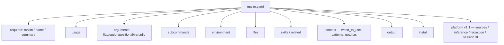

# Project Schema — Summary

> **No relational database / no DB schema.** mallm is a CLI with **file-backed** local state under
> XDG dirs. It defines: the `mallm.yaml` doc format (JSON Schema draft 2020-12 at
> `schemas/mallm.schema.json`, versions `1.0`/`1.1`), the platform config file, the session KV, the
> redacted history log, `knowledge.yaml`, corpus cache metadata, and the `howtos[]` write-back section.

## Data inventory

| Artifact | Location | Notes |
|----------|----------|-------|
| mallm.yaml (project) | `<git-root>/.mallm/<app>.yaml` | Tier-1 lookup |
| mallm.yaml (user) | `~/.config/mallm/<app>/mallm.yaml` | Tier-2 lookup |
| Native / help | `<app> --mallm` / `--help` | Tier-3 / Tier-4 |
| Platform config | `.mallm/config.yaml` → `~/.config/mallm/config.yaml` | `sources`, `inference`, `redaction.patterns`, `sessionTtl` (`86400`) |
| Session KV | `$XDG_DATA_HOME/mallm/sessions/<token>.json` | buckets env/downloads/installed/approvals/decisions/howto |
| History | `$XDG_DATA_HOME/mallm/history.jsonl` | append-only, pre-redacted records |
| Knowledge | `~/.config/mallm/knowledge.yaml` | topics `{id,name,confidence 0-10,lastSeen,sources}` |
| Corpus cache | `$XDG_CACHE_HOME/mallm/corpus/<key>/` | payload/clone + `meta.json` (`etag`/`commit`/`sha256`/`fetchedAt`) |
| `howtos[]` | inside a corpus source doc | `{title,goal,os,tags,script,provenance}` — not yet in JSON Schema |

## CLI command surface

| Command | Flags |
|---------|-------|
| `mallm [app]` / `show <app>` | `--json`, `--version <ver>`, `--agent` |
| `init <app>` | `--global` |
| `list` | `--json` |
| `validate <path>` | exits 1 on failure |
| `schema` | prints JSON Schema |
| `sources list\|add\|update` | `--kind`, `--url`, `--repo`, `--branch`, `--priority`, `--creds-ref`, `--token-env` |
| `session`, `session clear`, `session approve\|deny` | `--token`, `--expired`, `--json`, `--note` |
| `history` | `--session`, `--tail`, `--json` |
| `doctor` | `--json` |
| `how-to` | `--tool`, `--dry-run`, `--pick`, `--approve-install`, `--approve-run`, `--json` |
| `search` | `--refresh`, `--json` |
| `quiz` / `learn` | `--topic`, `--limit`, `--json` |

Global: `--session`, `--os`, `--os-version`, `--tool-version`, `--json`, `--no-color`. `--json` adds a
`_meta`/fold provenance object that is not part of the schema. No secret **values** are stored; config
names env vars (`apiKeyEnv`, `tokenEnv`; Jev uses `JEV_API_KEY`/`TYPESAFE_API_KEY`).
