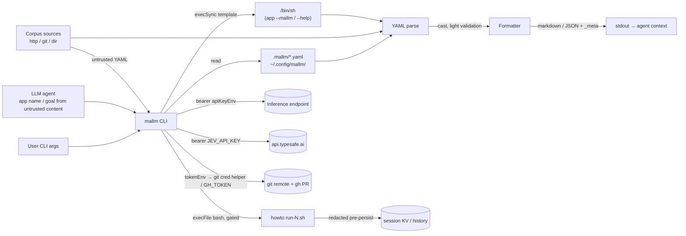

# Threat Model

## Overview

`mallm` is a local CLI: it reads YAML files, shells out to the tool being documented, drafts and
(under approval) runs bash, and prints Markdown/JSON to stdout. It has no network listener and no
database, but it does make outbound calls on explicit action — corpus source sync (http/git), LLM
inference, the Jev (TypeSafe systemone) client, and write-back push/PR — and persists local state
(sessions, history, knowledge, corpus cache).

The dominant trust boundary is **not** a network perimeter. It is data → execution and data →
egress: the `app` argument and YAML/LLM content flow into `execSync` shell strings and into
agent-consumed output, and prompts + corpus + probe data flow out to third-party inference
endpoints carrying provider API keys.

Assets at stake: the invoking user's shell (command execution), the correctness of context fed to
LLM agents (rendered documentation), and the provider API keys / write-back tokens used for egress.

Grounding: components and pipeline per [PROJ-ARCH.md](PROJ-ARCH.md); file locations per
[PROJ-LAYOUT.md](PROJ-LAYOUT.md); data shapes per [PROJ-SCHEMA.md](PROJ-SCHEMA.md).

## Attack Surface

Trust boundaries crossed: (1) untrusted-content-derived `app` name → shell execution; (2) arbitrary
YAML (project files, native-tier stdout, corpus payloads) → agent-consumed output; (3) LLM/corpus
content → bash execution (approval-gated); (4) local prompts/corpus/env → third-party inference with
API keys; (5) write-back token → git/gh child processes.

## Vulnerability Register

| ID | Severity | STRIDE | Component | Status |
|----|----------|--------|-----------|--------|
| T-001 | High | Tampering / EoP | `resolver.ts` (`tryNative`, `tryHelpFallback`), `init.ts` | **Open** — `app` interpolated into `execSync` template strings (`${app} --mallm`, `${app} --help 2>&1 || …`) with no sanitization; shell metacharacters execute. Direct human use is self-inflicted, but an agent passing an app name derived from untrusted content (prompt injection) crosses a real boundary. |
| T-002 | Medium | Tampering | `resolver.ts` `loadYaml`/`tryNative`, `corpus/adapters.ts` | **Open** — parsed YAML is cast `as MallmConfig` with zero structural validation at read time; corpus docs are likewise merged and emitted unvalidated. `mallm validate` exists but neither the resolver nor the corpus path calls it. Hostile definitions flow into agent-consumed output (documentation injection → confused deputy). |
| T-003 | Low | DoS | `resolver.ts`, `corpus/`, `env/probe.ts` | **Partial** — `yaml@2` alias caps, 5 s exec timeouts, 10–120 s network timeouts, 32 MB git `maxBuffer`, `maxAliasCount` defaults; deeply nested YAML can still cost parse time. Accepted for a local tool. |
| T-004 | Low | Info disclosure | `formatter.ts`, `help-parser.ts`, `howto/cli.ts` | **Accepted** — `_meta`/`docPath` exposes local filesystem paths; help text folds target-tool stderr, so diagnostics (potentially sensitive) land in output. Local-trust context; informational. |
| T-005 | Low | Tampering | `init.ts` | **Open** — `app` is joined into output paths (`join(root, ".mallm", `${app}.yaml`)`, `join(homedir(), …, app)`) without traversal checks; `../`-laden names write outside the intended dirs. Same-user trust limits impact. |
| T-006 | Low | Supply chain | `package.json` | **Accepted** — small dependency set (`commander`, `yaml`, `chalk`), pinned lockfile; the wave-1/2 modules added **no** new runtime dependencies. Standard npm scrutiny. |
| T-007 | Medium | EoP / Tampering | `howto/machine.ts`, `howto/cli.ts`, `howto/drafts.ts` | **Mitigated (residual)** — the GATE_RUN stage executes bash drafted by the LLM or adapted from the corpus. There is no `--yes`: each run attempt needs an explicit, per-attempt approval (`howto-run:<n>`), install needs a plan-hash-scoped approval, `--dry-run` stops before any install/run, and stdout/stderr are redacted strictly before persistence. Residual: a user who approves a poisoned script executes it with their own privileges (the gate is consent, not sandboxing). |
| T-008 | Medium | Info disclosure | `llm/client.ts`, `jev/client.ts` | **Partial** — goals, environment probe data, corpus excerpts and (pre-redacted) run output are sent to configurable inference / TypeSafe endpoints with provider keys in the `Authorization` header. Keys travel only in headers; error strings carry env var **names**, never values. Residual: prompt/corpus data leaves the host to a third party once inference is configured. |
| T-009 | Low | Tampering / SSRF | `corpus/adapters.ts`, `config/loader.ts` | **Partial** — `sources[]` may point at arbitrary http URLs / git remotes / local dirs; fetching/cloning them is user-configured (not attacker-controlled unless config is compromised). Payloads are untrusted YAML feeding output and script drafting (compounds T-002). `dir` sources are read as the user. |
| T-010 | Low | Info disclosure | `howto/writeback.ts` | **Mitigated** — write-back push/PR token is read from `sources[].tokenEnv` (a name) and injected via an env-expanded git credential helper; `gh` reads `GH_TOKEN` from env. The token never appears in argv or remote URLs, and every error path is redacted. Residual: the token is present in the child-process environment, readable by same-user processes. |

## Mitigation Coverage

10 register entries: **2 mitigated with residual** (T-007, T-010) · **3 partial** (T-003, T-008,
T-009) · **2 accepted** (T-004, T-006) · **3 open** (T-001, T-002, T-005). No external tickets.

Recommended remediations (map to IDs):

- **T-001**: replace `execSync` template strings in `resolver.ts`/`init.ts` with
  `execFileSync(app, ["--mallm"])` (argv array, no shell), or reject `app` names outside
  `[A-Za-z0-9._-]+`. Probe `--help`/`-h` as separate argv calls rather than an `|| true` shell chain.
- **T-002 / T-009**: run the JSON Schema (or `validate`) on every load and on every corpus doc before
  it reaches the formatter; treat `sources[]` payloads as untrusted.
- **T-005**: validate `app` as a single path segment before any `join`.
- **T-007 / T-008 / T-010**: keep the approval gates and pre-persist redaction as invariants; document
  that enabling `inference` sends prompt data off-host, and prefer least-privilege tokens for
  `tokenEnv`.

## Residual Risk

mallm assumes the invoking principal trusts their own filesystem and PATH — standard for a dev CLI.
Deliberately accepted residuals: agent-mediated shell injection (T-001) until argv-array execution
lands — treat `mallm show <app>` with an agent-sourced `app` name as shell-equivalent; execution of an
*approved* LLM-drafted script (T-007), where the gate is informed consent rather than a sandbox; and
prompt/corpus egress (T-008) once inference is configured. No secret values are read, stored, or
emitted by mallm itself; revocation needs are limited to rotating a configured provider/write-back
key and removing a definition or source file.
